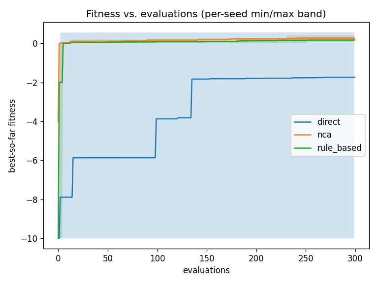
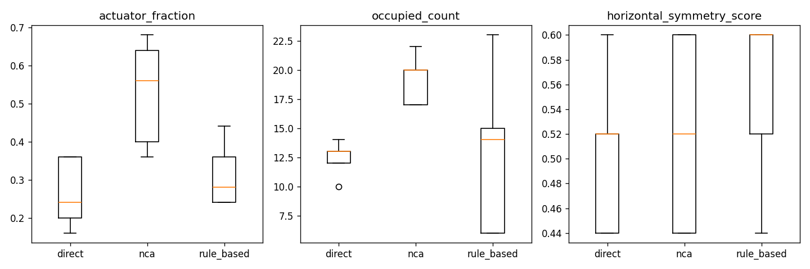
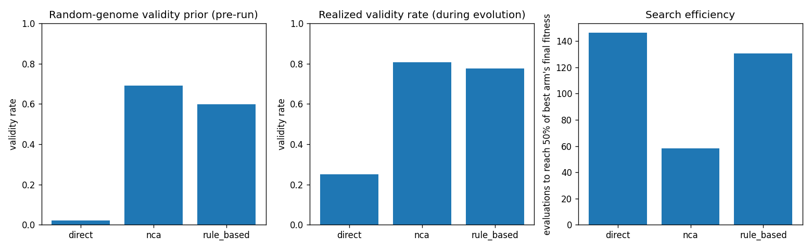

# Benchmark Report: Direct vs. NCA vs. Rule-Based Morphology Encodings

**Headline:** No detectable difference between arms: across every pairwise comparison, the bootstrap confidence interval for the mean-fitness difference includes zero.

## Research question

Does the choice of genome-to-morphology encoding (a direct per-voxel encoding, a Neural Cellular Automaton, or a symbolic developmental rule system) change evolutionary search efficiency or final locomotion fitness on a fixed 5x5 voxel soft robot, when every other part of the pipeline (task, PPO budget, population size, evaluation budget, validation policy, invalid-genome accounting) is held identical across arms? The novelty claimed here is the controlled, identical-conditions three-way comparison itself -- not the invention of any one encoding (NCA-for-soft-robots and symbolic developmental rules both predate this project).

## Fairness protocol (as actually resolved from the benchmark manifest)

- Git commit: `9e5cef87f5777b7c66397fea008a53a44229b907`
- Surrogate mode: `False`
- Shared config (verified identical across every arm before any run started):

| Field | Value |
|---|---|
| cache_enabled | False |
| eval_budget | 300 |
| grid_shape | [5, 5] |
| min_actuators | 1 |
| min_voxels | 3 |
| offspring_size | 15 |
| population_size | 15 |
| ppo_eval_episodes | 1 |
| ppo_timesteps | 5000 |
| sentinel_fitness | -10.0 |
| use_crossover | False |

- Per-encoder configuration (`describe()`):

  - **direct**: `{'empty_prob': 0.6, 'grid_shape': [5, 5], 'mutation_rate': 0.1, 'name': 'direct'}`
  - **nca**: `{'channels': 8, 'dev_steps': 10, 'genome_length': 792, 'grid_shape': [5, 5], 'hidden_channels': 3, 'hidden_width': 16, 'init_scale': 0.5, 'mutation_fraction': 1.0, 'mutation_sigma': 0.1, 'name': 'nca', 'neighbourhood': 'von_neumann'}`
  - **rule_based**: `{'action_types': ['set_empty', 'set_soft', 'set_hard', 'set_actuator_horizontal', 'set_actuator_vertical', 'grow_directional', 'copy_neighbor'], 'condition_types': ['always', 'cell_type', 'neighbor_count', 'empty_neighbor', 'position'], 'developmental_iterations': 5, 'grid_shape': [5, 5], 'max_rules': 12, 'min_rules': 2, 'mutation_rate': 0.2, 'name': 'rule_based'}`

- Library versions: `{'matplotlib': '3.10.9', 'numpy': '1.26.4', 'pandas': '2.3.3', 'pytest': '9.1.1', 'python': '3.10.20 (main, Mar  3 2026, 00:49:35) [Clang 21.0.0 (clang-2100.0.123.102)]', 'yaml': '6.0.3'}`

## Three-way comparison table

| encoder | n_seeds | final_best_fitness_mean | final_best_fitness_std | evaluations_to_50pct_of_best_arm_mean | evaluations_to_90pct_of_best_arm_mean | validity_rate | unique_bodies_explored | cache_hit_rate | mean_wall_clock_s_per_eval |
|---|---|---|---|---|---|---|---|---|---|
| direct | 5 | -1.7371 | 4.1335 | 146.2500 | 131.6667 | 0.2507 | 1203 | 0.0000 | 1.9918 |
| nca | 5 | 0.2772 | 0.0937 | 58.4000 | 163.3333 | 0.8073 | 1498 | 0.0000 | 6.6742 |
| rule_based | 5 | 0.1783 | 0.0749 | 130.6667 | 223.0000 | 0.7760 | 604 | 0.0000 | 6.2188 |

## Figures

## Statistical comparison

With only a handful of seeds per arm, no statistical test here can support a strong claim -- see `evodevo/analysis/statistics.py`'s module docstring. Overlapping confidence intervals are reported as **no detectable difference**, never as evidence of equivalence.

| Arm A | Arm B | Metric | Mean diff (A-B) | 95% CI | Cliff's delta | Mann-Whitney U | p (approx) | Verdict |
|---|---|---|---|---|---|---|---|---|
| direct | nca | final_best_fitness | -2.0143 | [-6.1547, 0.1696] | -0.040 | 12.0 | 0.9168 | no detectable difference |
| direct | rule_based | final_best_fitness | -1.9154 | [-6.0629, 0.2658] | 0.280 | 16.0 | 0.4647 | no detectable difference |
| nca | rule_based | final_best_fitness | 0.0989 | [-0.0011, 0.2073] | 0.520 | 19.0 | 0.1745 | no detectable difference |

## Threats to validity

- **Seed count**: 5 seed(s) per arm in this run. This is far too few to support strong statistical claims; treat every comparison above as indicative, not conclusive.
- **PPO budget**: this comparison's `ppo_timesteps` is far below EvoGym's own >1e6-timestep recommendation for a serious PPO run on a soft-robot locomotion task; fitness numbers here reflect a heavily truncated training budget, not converged policies.
- **Single task family**: this run covers only the task(s) listed in the fairness protocol section above; results may not generalize to other EvoGym environments.
- **Per-arm mutation-strength tuning asymmetry**: mutation rate/sigma cannot be equalized across a categorical genome (direct), a continuous weight vector (NCA), and a variable-length rule list (Rule-Based); each arm's mutation strength was set independently, not via a shared tuning procedure, which is a potential confound in any efficiency comparison.
- **NCA's known non-settling behaviour**: at default hyperparameters, 68.35% of random NCA genomes are still changing state on the final developmental step (never observably settled within `dev_steps`), and residual-state magnitude at t=T averages ~40.7 against an initial-state scale of 0.1 -- the residual update is not bounded/self-stabilizing (see `results/nca_sanity.md`).
- **Grid size**: a 5x5 voxel grid may be too small for either developmental encoding (NCA or Rule-Based) to express any advantage over direct per-voxel encoding -- developmental/generative representations are generally expected to pay off at larger genome/phenotype sizes where direct encoding's search space becomes intractable, which this project's fixed 5x5 grid does not test.
