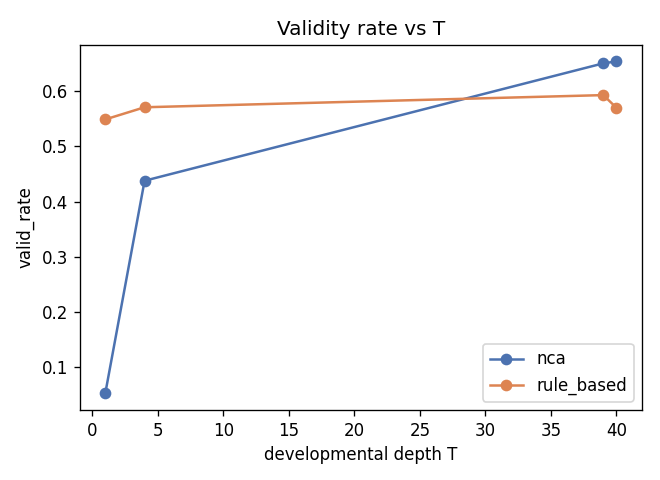
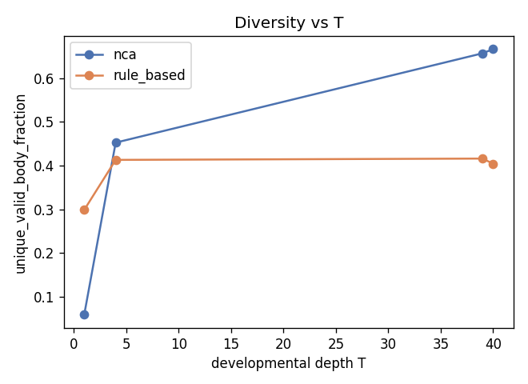
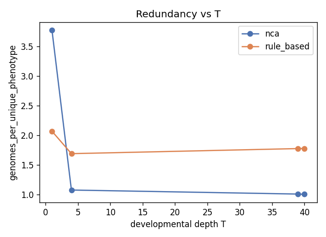
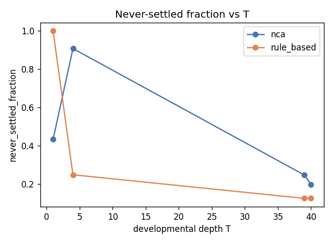
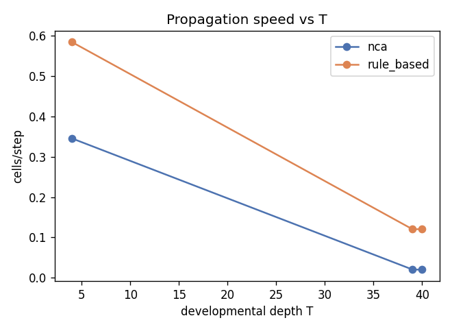
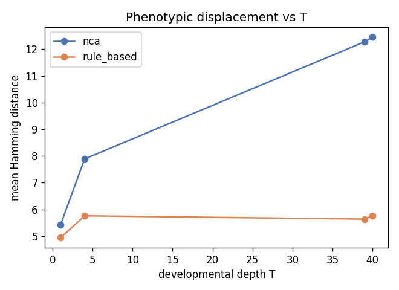
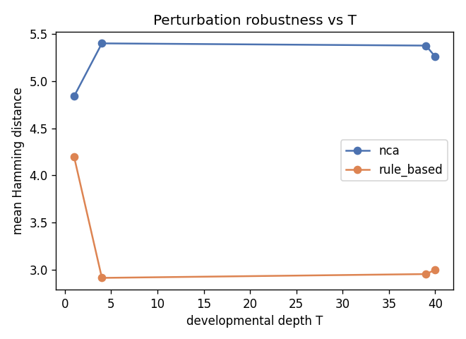

# Depth study (developmental depth T)

Fitness-blind (evodevo/analysis/structural.py, evodevo/analysis/depth_study.py). N=2000 genomes/cell, init_condition=`center_seed` (the P3 decision), seed=0. No PPO, no task, no reward were run to produce any number on this page.

## Layer 1: verifying the reach invariant

`light_cone` measurement at the P3 initial condition (`center_seed` -- a single seed at the grid centre), N=2000 genomes/arm, T_max=40.

| arm | fitted speed (cells/step) | never_reached_fraction | step p10 | step median | step p90 | per-pair speed p10 | per-pair speed median | per-pair speed p90 |
| --- | --- | --- | --- | --- | --- | --- | --- | --- |
| nca | 0.0194 | 0.3658 | 3.0000 | 10.0000 | 28.0000 | 0.0800 | 0.2500 | 0.6667 |
| rule_based | 0.2548 | 0.9592 | 1.0000 | 1.0000 | 4.0000 | 0.5000 | 1.0000 | 1.0000 |

**Hypothesis: NCA's effective speed is below 1.0 cell/step** (a small residual delta arriving from a neighbour may need several steps to accumulate enough magnitude to flip an argmax). Measured: nca fitted speed = 0.0194 cells/step (median per-pair speed 0.2500), rule_based fitted speed = 0.2548 cells/step (median per-pair speed 1.0000). 
**Confirmed**: nca's fitted speed (0.0194) is below 1.0, consistent with the accumulate-then-flip hypothesis -- residual deltas from a single neighbouring cell rarely flip an argmax in exactly one step.

Ratio nca/rule_based = 0.0763 (92.4% difference).

**Geometric lower bound.** On a 5x5 grid, the maximum Manhattan distance from the centre to any cell is 4, and corner-to-corner is 8. The P3 initial condition (`center_seed`) seeds development from the grid CENTRE, and `light_cone`'s own perturbation is also applied at the centre cell -- so the bound that applies here is **T >= 4** (centre-to-any-cell), not the corner-to-corner bound of 8, which would only be the relevant bound for a perturbation or seed placed at a corner (not the case under the chosen P3 condition or this measurement).


**Speeds differ by more than 20% -- a speed-corrected depth sensitivity analysis is required (see Layer 2's T_primary derivation section below, once T_primary is known).**
## Layer 2: selecting T from measured convergence

`settling_profile` at T_max=40, N=2000/arm, init_condition=`center_seed`.

| arm | median settle_step | p95 settle_step | never_settled_count | never_settled_fraction | stabilize_by_step<=1 | stabilize_by_step<=2 |
| --- | --- | --- | --- | --- | --- | --- |
| nca | 37.0000 | 39.0000 | 418 | 0.2090 | 0.0013 | 0.0038 |
| rule_based | 2.0000 | 5.0000 | 231 | 0.1155 | 0.3279 | 0.7106 |

never_settled_count is reported explicitly for every arm above -- it is never dropped or coerced to a default.

### Asymmetric-loss justification (verbatim)

```
The cost of mis-specifying T is asymmetric. Granting an arm more steps than it
needs is semantically free, because once development reaches a fixed point further
steps are idempotent and cannot change the phenotype. Granting an arm fewer steps
than it needs is semantically destructive, because it truncates development and
evaluates an unfinished phenotype. Under an asymmetric loss, the optimum is the
maximum of the arms' convergence horizons, not a compromise between them.

This argument holds only for arms whose development CONVERGES. For an arm whose
state diverges rather than settling, extra steps are not free, and the argument
does not apply until that divergence is resolved.
```

### Idempotence verification

- nca: checked 1582 settled genomes (of 2000); 0 violation(s) (body changed again after its recorded settle_step, before T_max).
- rule_based: checked 1769 settled genomes (of 2000); 0 violation(s) (body changed again after its recorded settle_step, before T_max).

**Idempotence premise empirically confirmed**: 0/3351 settled genomes across both arms showed any further body change between their recorded settle_step and T_max. Development that settles genuinely stays settled within the measured horizon -- extra steps beyond settle_step are confirmed free for these genomes, not merely assumed.

### NCA divergence detail

- initial reference scale (max\|state\| at t=0): 5.0000
- fraction of genomes whose max-abs state ever exceeds 10x that scale within T_max: 1.0000 (median step: 12.0000)
- fraction exceeding 100x: 0.0000 (median step: None)
- mean/median final (t=T_max) max-abs state magnitude: 185.5189 / 182.1530

### Argmax-stabilisation distribution (headline number for NCA)

The argmax-stabilisation step IS `settle_step` (defined as the last step at which the decoded argmax body changed) -- reused directly, not a separate measurement. For NCA: 0.0013 of genomes have their final phenotype decided by step 1, 0.0038 by step 2, median settle_step=37.0000, while the state magnitude analysis above shows the continuous state continues growing (often past 10x/100x the initial scale) long after that. 
This sample does not show the majority of NCA genomes stabilising within the first 2 steps; see the full median/p95 above for the actual argmax-stabilisation horizon.

### T_primary derivation

T_primary = ceil(max over developmental arms of q95(settle_step)), clipped to [4, 40] (floor = geometric minimum; ceiling = T_MAX_HARD_CAP -- developmental steps are cheap forward passes evaluated before PPO training starts, so there is no compute justification for any tighter ceiling; a previous version of this derivation used an unjustified [4, 20] ceiling that capped T_primary below nca's own q95/median settle_step -- see docs/decisions.md for the correction). q95 values: nca=39.0000, rule_based=5.0000. max = 39.0000 -> **T_primary = 39**.


### Speed-corrected depth sensitivity analysis

Layer 1 found nca and rule_based's fitted propagation speeds differ by more than 20%. **Equal-T and equal-reach are NOT the same protocol under these measurements.** As a sensitivity analysis (not a replacement for the primary equal-T protocol above), a speed-corrected depth T_arm = round(T_primary * speed_reference / speed_arm), with speed_reference = max(nca, rule_based) = 0.2548 (the `rule_based` arm):

| arm | fitted speed | T_arm = round(T_primary * speed_reference / speed_arm) |
| --- | --- | --- |
| nca | 0.0194 | 511 |
| rule_based | 0.2548 | 39 |

This sensitivity analysis is reported for transparency; it is a SEPARATE, explicitly labelled protocol from the primary equal-T comparison, per the requirement that any use of different T per arm must be justified by this exact correction and labelled as such -- it is not applied to the primary comparison or the depth sweep in Layer 3 below.

## Diagnosis of non-settling genomes (T_max=40)

Every NCA genome recorded as never_settled in Layer 2 (T_max=40, center_seed) is classified into exactly one of three categories from its full state_magnitude_trace and argmax flip history -- diagnosis only, no update-rule change made here regardless of the answer.

- **STILL_GROWING**: max-abs state magnitude at step 40 exceeds step 35's by more than 5% -- genuinely still diverging, not close to any fixed point.
- **PLATEAUED_OSCILLATING**: magnitude has stabilised (within 5% over the last 5 steps) but the argmax readout is still flipping -- two or more material channels are persistently near-tied.
- **SLOW_BUT_MONOTONE**: neither of the above -- magnitude is still changing, but not fast enough to count as STILL_GROWING and not stable enough to count as PLATEAUED_OSCILLATING; consistent with "would settle given more T".

**Breakdown** (n=418 never-settled genomes):

| category | count | fraction |
| --- | --- | --- |
| STILL_GROWING | 416 | 0.9952 |
| PLATEAUED_OSCILLATING | 2 | 0.0048 |
| SLOW_BUT_MONOTONE | 0 | 0.0000 |

**Largest category: STILL_GROWING** (416/418).

**Verdict**: the dominant failure mode (STILL_GROWING) is a genuine instability, not merely T_max being too short for an honest slow minority -- this is evidence for the NCA architecture/update-rule work, not something a larger T_max alone would necessarily resolve. No architecture change is made in this prompt.

### Example trajectories from `STILL_GROWING` (largest category)

1. magnitude at step 35 = 109.7830, step 40 = 129.3684, last-5-step magnitudes = [113.7, 117.617, 121.534, 125.451, 129.368]; argmax flip steps in the last 5 steps = [36, 38, 40] (total flips across the full T=40 trajectory: 21).
2. magnitude at step 35 = 134.3529, step 40 = 150.2263, last-5-step magnitudes = [137.528, 140.702, 143.877, 147.052, 150.226]; argmax flip steps in the last 5 steps = [38, 40] (total flips across the full T=40 trajectory: 21).
3. magnitude at step 35 = 154.0703, step 40 = 176.2163, last-5-step magnitudes = [158.501, 163.106, 167.477, 171.847, 176.216]; argmax flip steps in the last 5 steps = [40] (total flips across the full T=40 trajectory: 17).

## Layer 3: T as a crossed factor

Depth sweep T in [1, 4, 39, 40] (T=1: shared non-developmental control, marked NON-DROPPABLE under any compute cut; T=4: geometric minimum; T_primary; min(2*T_primary, T_MAX_HARD_CAP): stability-past-horizon check), N=2000/cell, init_condition=`center_seed`.

**Note**: 2*T_primary = 2*39 = 78 exceeds T_MAX_HARD_CAP=40, so the sweep's fourth cell is clamped to min(2*T_primary, T_MAX_HARD_CAP) = 40 itself, NOT a genuine 2x-T_primary probe -- the 'stability past 2x the convergence horizon' cell and the 'developmental hard ceiling' cell coincide for this run. There is no depth point in this sweep that tests behaviour strictly beyond T_MAX_HARD_CAP=40.

| metric | arm | T=1 | T=4 | T=39 | T=40 |
| --- | --- | --- | --- | --- | --- |
| validity_rate.valid_rate | nca | 0.0530 | 0.4380 | 0.6505 | 0.6540 |
| validity_rate.valid_rate | rule_based | 0.5490 | 0.5710 | 0.5930 | 0.5700 |
| diversity.unique_valid_body_fraction | nca | 0.0585 | 0.4525 | 0.6570 | 0.6665 |
| diversity.unique_valid_body_fraction | rule_based | 0.2985 | 0.4130 | 0.4160 | 0.4040 |
| redundancy.genomes_per_unique_phenotype | nca | 3.7736 | 1.0782 | 1.0101 | 1.0065 |
| redundancy.genomes_per_unique_phenotype | rule_based | 2.0704 | 1.6920 | 1.7778 | 1.7794 |
| settling_profile.never_settled_fraction | nca | 0.4330 | 0.9080 | 0.2460 | 0.1970 |
| settling_profile.never_settled_fraction | rule_based | 1.0000 | 0.2475 | 0.1240 | 0.1240 |
| light_cone.propagation_speed_cells_per_step | nca | None | 0.3456 | 0.0202 | 0.0198 |
| light_cone.propagation_speed_cells_per_step | rule_based | None | 0.5846 | 0.1202 | 0.1202 |
| phenotypic_displacement.mean_hamming_distance | nca | 5.4285 | 7.8895 | 12.2760 | 12.4535 |
| phenotypic_displacement.mean_hamming_distance | rule_based | 4.9385 | 5.7595 | 5.6360 | 5.7690 |
| perturbation_robustness.mean_hamming_distance | nca | 4.8385 | 5.3990 | 5.3755 | 5.2575 |
| perturbation_robustness.mean_hamming_distance | rule_based | 4.1960 | 2.9135 | 2.9540 | 2.9985 |















### Which conclusions are stable across the depth sweep

For each metric, the largest range observed across T (within the more-variable arm) is reported below; a small range means that metric's conclusion is stable regardless of exactly which T in the sweep is used, and a large range means T materially changes the picture and any single-T comparison risks being an artefact of that choice:

- `phenotypic_displacement.mean_hamming_distance`: max range across T = 7.0250 (largest in `nca`)
- `redundancy.genomes_per_unique_phenotype`: max range across T = 2.7670 (largest in `nca`)
- `perturbation_robustness.mean_hamming_distance`: max range across T = 1.2825 (largest in `rule_based`)
- `settling_profile.never_settled_fraction`: max range across T = 0.8760 (largest in `rule_based`)
- `diversity.unique_valid_body_fraction`: max range across T = 0.6080 (largest in `nca`)
- `validity_rate.valid_rate`: max range across T = 0.6010 (largest in `nca`)
- `light_cone.propagation_speed_cells_per_step`: max range across T = 0.4644 (largest in `rule_based`)
