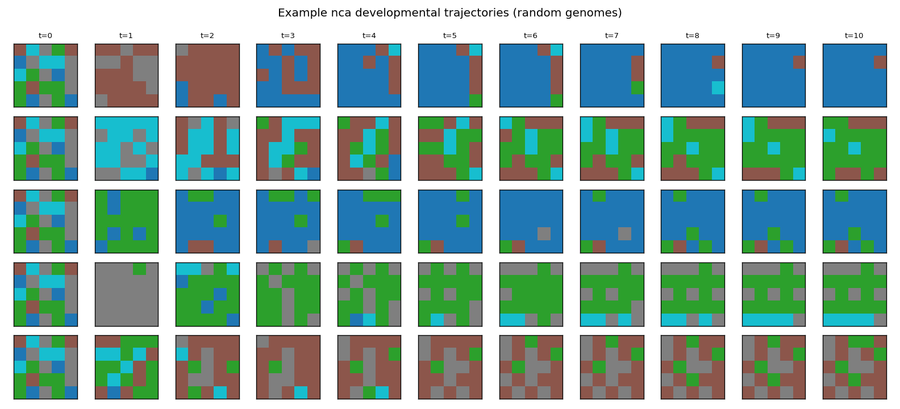

> **SUPERSEDED as of 2026-09-19 (architecture context, not the numbers
> themselves).** Same content/vintage as `results/nca_sanity.md` (confirmed
> byte-for-byte identical per `docs/decisions.md`'s "Pre-launch audit
> reconfirmation" row) — measured under the pre-redesign NCA (`dev_steps=10`,
> `hidden_channels=3`, unbounded-residual `_step`, no `update_rule` concept).
> The current resolved NCA (`evodevo/encoders/nca/resolved_config.py::PRIMARY`:
> `update_rule="bounded_leaky"`, `hidden_channels=0`, shared `T_primary=100`)
> behaves very differently — see `results/nca/ARCHITECTURE_DELTA.md`'s
> before/after table.

# nca Encoder Sanity Report

N = 2000 random genomes, seed = 0. No PPO was run for this experiment.

## Validity and diversity

| Metric | Value |
|---|---|
| Validity rate | 0.6915 |
| Unique body hashes | 1966 (0.9830) |
| All-empty fraction | 0.0035 |
| Uniform non-empty fraction | 0.0160 |
| Degenerate fraction (all-empty + uniform) | 0.0195 |

### Invalid-genome failure reasons

| Reason category | Count |
|---|---|
| disconnected | 527 |
| no_actuator | 128 |
| too_few_voxels | 28 |

## Developmental stability (nca only)

Never-settled fraction (still changing on the final transition, t=9 -> t=10): 0.6835

Settle-step distribution (step index after which the argmax body never changes again):

| Step | Count |
|---|---|
| 0 | 0 |
| 1 | 5 |
| 2 | 6 |
| 3 | 8 |
| 4 | 9 |
| 5 | 14 |
| 6 | 18 |
| 7 | 53 |
| 8 | 122 |
| 9 | 398 |
| 10 | 1367 |

## Residual state magnitude at t=T (nca only)

max |state| across cells/channels at t=T, across genomes: mean=40.655, median=39.951, min=21.123, max=77.255

## Example developmental trajectories

## Decision gate

- PASS: validity rate and degenerate-body fraction are both within the decision-gate thresholds.
