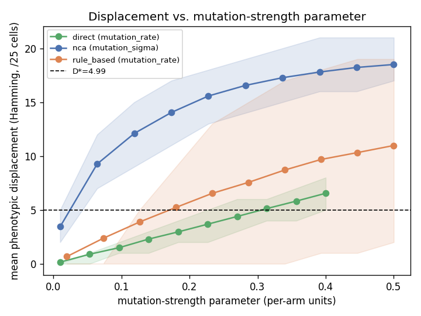
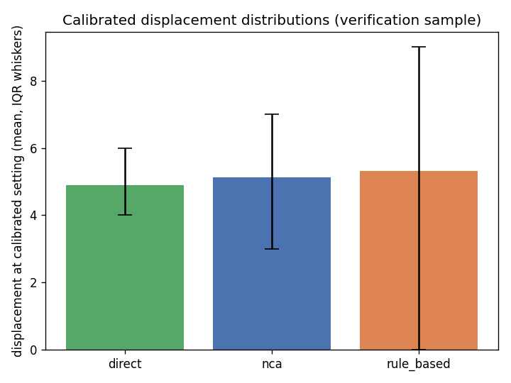

# Mutation calibration: equalising phenotypic displacement

Fitness-blind (evodevo/analysis/mutation_calibration.py; only decode()/mutate()/validate_body are ever called -- NO PPO, NO task, NO reward, NO fitness quantity anywhere in this module). N=2000 valid random parents per grid point, 10-point grid per arm, init_condition=`center_seed` (P3), dev_steps=20 (P4 T_primary), seed=0 (sweep) / 10000 (independent verification sample).

## Displacement vs. parameter sweep

### direct (`mutation_rate`)

| param | mean | median | q25 | q75 | iqr | std |
| --- | --- | --- | --- | --- | --- | --- |
| 0.0100 | 0.1495 | 0.0000 | 0.0000 | 0.0000 | 0.0000 | 0.3836 |
| 0.0533 | 0.8855 | 1.0000 | 0.0000 | 1.0000 | 1.0000 | 0.9335 |
| 0.0967 | 1.4935 | 1.0000 | 1.0000 | 2.0000 | 1.0000 | 1.1734 |
| 0.1400 | 2.2915 | 2.0000 | 1.0000 | 3.0000 | 2.0000 | 1.4455 |
| 0.1833 | 2.9590 | 3.0000 | 2.0000 | 4.0000 | 2.0000 | 1.6478 |
| 0.2267 | 3.6735 | 4.0000 | 2.0000 | 5.0000 | 3.0000 | 1.8083 |
| 0.2700 | 4.3905 | 4.0000 | 3.0000 | 6.0000 | 3.0000 | 1.8926 |
| 0.3133 | 5.1200 | 5.0000 | 4.0000 | 6.0000 | 2.0000 | 2.0036 |
| 0.3567 | 5.8145 | 6.0000 | 4.0000 | 7.0000 | 3.0000 | 2.1338 |
| 0.4000 | 6.5430 | 6.0000 | 5.0000 | 8.0000 | 3.0000 | 2.2568 |

### nca (`mutation_sigma`)

| param | mean | median | q25 | q75 | iqr | std |
| --- | --- | --- | --- | --- | --- | --- |
| 0.0100 | 3.4400 | 3.0000 | 2.0000 | 5.0000 | 3.0000 | 2.3485 |
| 0.0644 | 9.2660 | 9.0000 | 7.0000 | 12.0000 | 5.0000 | 3.7266 |
| 0.1189 | 12.0985 | 12.0000 | 9.0000 | 15.0000 | 6.0000 | 4.1634 |
| 0.1733 | 14.0435 | 14.0000 | 11.0000 | 17.0000 | 6.0000 | 4.2110 |
| 0.2278 | 15.5735 | 16.0000 | 13.0000 | 18.0000 | 5.0000 | 4.1163 |
| 0.2822 | 16.5565 | 17.0000 | 14.0000 | 19.0000 | 5.0000 | 4.0640 |
| 0.3367 | 17.2725 | 18.0000 | 15.0000 | 20.0000 | 5.0000 | 3.9610 |
| 0.3911 | 17.7975 | 18.0000 | 16.0000 | 21.0000 | 5.0000 | 3.8648 |
| 0.4456 | 18.2225 | 19.0000 | 16.0000 | 21.0000 | 5.0000 | 3.7473 |
| 0.5000 | 18.4980 | 19.0000 | 17.0000 | 21.0000 | 4.0000 | 3.6521 |

### rule_based (`mutation_rate`)

| param | mean | median | q25 | q75 | iqr | std |
| --- | --- | --- | --- | --- | --- | --- |
| 0.0200 | 0.6715 | 0.0000 | 0.0000 | 0.0000 | 0.0000 | 3.2289 |
| 0.0733 | 2.3655 | 0.0000 | 0.0000 | 0.0000 | 0.0000 | 5.6249 |
| 0.1267 | 3.8765 | 0.0000 | 0.0000 | 5.0000 | 5.0000 | 6.8301 |
| 0.1800 | 5.2280 | 0.0000 | 0.0000 | 9.0000 | 9.0000 | 7.5470 |
| 0.2333 | 6.5365 | 2.0000 | 0.0000 | 13.0000 | 13.0000 | 8.0986 |
| 0.2867 | 7.5570 | 5.0000 | 0.0000 | 15.0000 | 15.0000 | 8.3273 |
| 0.3400 | 8.7050 | 6.0000 | 0.0000 | 17.0000 | 17.0000 | 8.5460 |
| 0.3933 | 9.6840 | 8.0000 | 1.0000 | 18.0000 | 17.0000 | 8.6308 |
| 0.4467 | 10.3210 | 9.0000 | 1.0000 | 19.0000 | 18.0000 | 8.6499 |
| 0.5000 | 10.9790 | 10.0000 | 2.0000 | 19.0000 | 17.0000 | 8.5688 |

## Target displacement D*

| arm | achievable mean-displacement range within its grid |
| --- | --- |
| direct | [0.1495, 6.5430] |
| nca | [3.4400, 18.4980] |
| rule_based | [0.6715, 10.9790] |

Jointly achievable range across all three arms: [3.4400, 6.5430]. Recommended target band: 2.0-3.0 cells changed out of 25 -- too small and mutation is mostly neutral (the EA barely explores beyond its parent), too large and the EA degenerates toward random search (each offspring becomes nearly unrelated to its parent, destroying the locality mutation-based search depends on).

**The recommended 2.0-3.0 band is NOT jointly achievable**: nca's OWN grid floor (`mutation_sigma`=0.01, the smallest allowed value) already produces a mean displacement of 3.4400, above the recommended band's upper end. This is consistent with the depth study's finding (`results/depth/DEPTH_STUDY.md`) that NCA's residual update is unbounded and its state magnitude grows large over `dev_steps=20`: `mutation_sigma` perturbs every one of NCA's ~792 weights simultaneously (default `mutation_fraction=1.0`), and even a tiny per-weight nudge compounds over 20 residual developmental steps into a phenotype-level change of several cells. D* was therefore chosen, honestly and not by fitting the recommendation, as the midpoint of the range that IS jointly achievable: **Chosen D* = 4.9915** (this is the real, reported outcome, not a workaround -- the 2.0-3.0 recommendation simply does not survive contact with NCA's measured sensitivity at this T_primary).

## Solved parameter values and verification

Each arm's parameter was solved by interpolating its sweep curve for D*=4.9915, then verified on a FRESH, independent N=2000 sample (different seed) -- stated tolerance: |mean - D*| <= 0.5 cells.

| arm | parameter | solved value | verification mean | verification median | verification IQR | within tolerance? |
| --- | --- | --- | --- | --- | --- | --- |
| direct | mutation_rate | 0.3057 | 4.8970 | 5.0000 | 2.0000 | YES |
| nca | mutation_sigma | 0.0201 | 5.1220 | 5.0000 | 4.0000 | YES |
| rule_based | mutation_rate | 0.1707 | 5.3100 | 0.0000 | 9.0000 | YES |

## Calibrated distributions side by side

Means at calibration (all targeting D*=4.9915): direct=4.8970, nca=5.1220, rule_based=5.3100.

IQRs at calibration: direct=2.0000, nca=4.0000, rule_based=9.0000 (spread across arms: 7.0000 cells). 
**The tails do NOT match as well as the means do**: despite all three arms hitting essentially the same mean displacement, their IQRs differ by 7.0000 cells -- i.e. this calibration equalises the first moment of phenotypic displacement but not its spread, and the tails (which drive search) can still differ materially between arms even after calibration. Q25/Q75 by arm: direct=[4.0000, 6.0000], nca=[3.0000, 7.0000], rule_based=[0.0000, 9.0000].

## Limitations (threats to validity)

Matching the first moment (mean) of phenotypic displacement does NOT equalise the mutation operators' underlying structure, and this limitation applies regardless of how well the calibration above numerically succeeds. Rule-based mutation is symbolic and discontinuous: a single mutated rule can change the interpreter's control flow for the rest of development (e.g. changing which condition an entire branch matches), producing a step-function-like effect on the phenotype. NCA mutation perturbs a fraction of the network's weights by a small additive Gaussian nudge applied simultaneously across the whole genome, changing every subsequent developmental step's computation by a small, continuous amount rather than altering one discrete decision. Direct mutation independently re-samples a subset of the 25 cells' categorical values directly in phenotype space, with no development in between at all. These are three qualitatively different operators that happen, at the calibrated settings, to move the decoded body by a similar expected Hamming distance -- they are not thereby equivalent operators, and any conclusion that depends on the operators' higher-order behaviour (e.g. how often a mutation is neutral vs. catastrophic, or how mutation effects compose over multiple generations) is not covered by this calibration and remains an open threat to validity.
