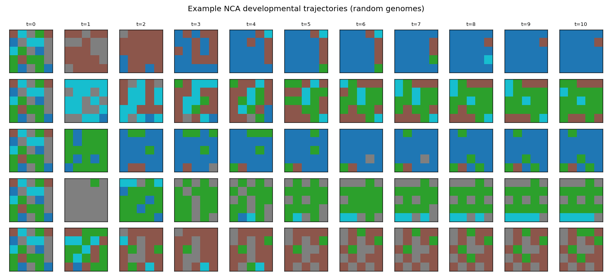

> **SUPERSEDED as of 2026-09-19 (architecture context, not the numbers
> themselves — a historically accurate E0 snapshot).** These numbers were
> measured under the pre-redesign NCA: `dev_steps=10`, `hidden_channels=3`,
> and the old unbounded-residual `_step` (no `update_rule`/`decay`/
> `state_bound` concept existed yet). They are cited by
> `results/BENCHMARK_REPORT.md` (superseded) as live evidence, which can read
> as describing the current NCA — it does not. The current resolved NCA
> (`evodevo/encoders/nca/resolved_config.py::PRIMARY`:
> `update_rule="bounded_leaky"`, `hidden_channels=0`, shared `T_primary=100`)
> has very different settling/state-magnitude behaviour — see
> `results/nca/ARCHITECTURE_DELTA.md`'s before/after table (e.g. max state
> magnitude at T dropped from a mean of 185.52 to 1.68 under the redesign).

# NCA Developmental Engine Sanity Report (E0)

N = 2000 random genomes per encoder, seed = 0. No PPO was run for this experiment.

## Validity and diversity

| Metric | NCA | Direct (reference) |
|---|---|---|
| Validity rate | 0.6915 | 0.0225 |
| Unique body hashes | 1966 (0.9830) | 2000 (1.0000) |
| All-empty fraction | 0.0035 | 0.0000 |
| Uniform non-empty fraction | 0.0160 | 0.0000 |
| Degenerate fraction (all-empty + uniform) | 0.0195 | 0.0000 |

### Invalid-genome failure reasons

| Reason category | NCA count | Direct count |
|---|---|---|
| disconnected | 527 | 1954 |
| no_actuator | 128 | 10 |
| too_few_voxels | 28 | 1 |

## Developmental stability (NCA only)

Never-settled fraction (still changing on the final transition, t=9 -> t=10): 0.6835

Settle-step distribution (step index after which the argmax body never changes again):

| Step | Count |
|---|---|
| 0 | 0 |
| 1 | 5 |
| 2 | 6 |
| 3 | 8 |
| 4 | 9 |
| 5 | 14 |
| 6 | 18 |
| 7 | 53 |
| 8 | 122 |
| 9 | 398 |
| 10 | 1367 |

## Residual state magnitude at t=T (NCA only)

max |state| across cells/channels at t=T, across genomes: mean=40.655, median=39.951, min=21.123, max=77.255

## Example developmental trajectories

## Decision gate

- PASS: validity rate and degenerate-body fraction are both within the decision-gate thresholds. See docs/decisions.md for the recorded numbers.
