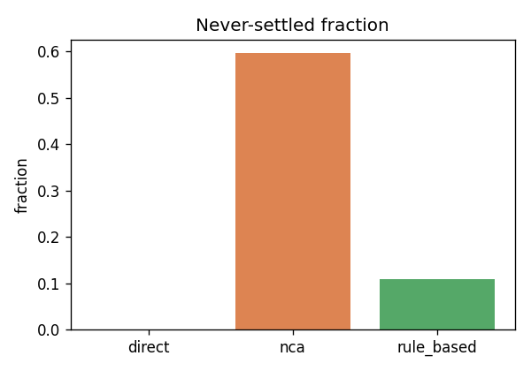
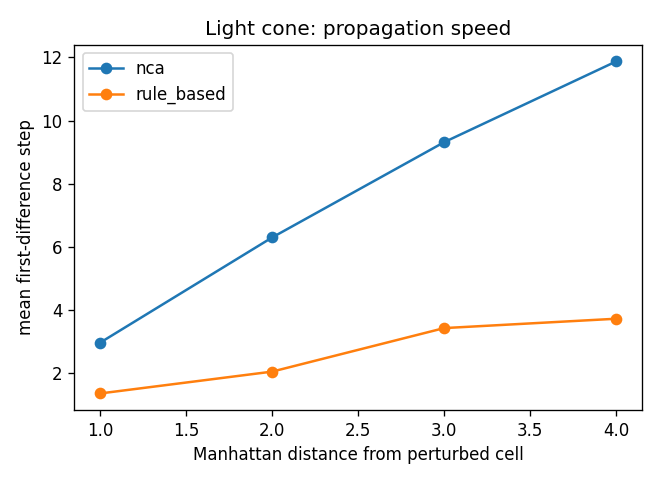
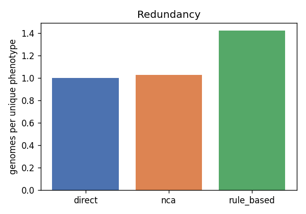
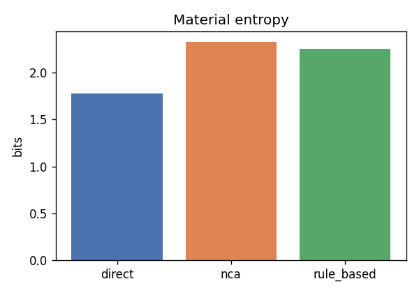
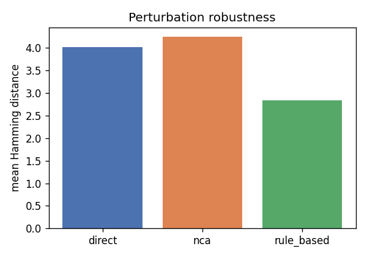

# Structural report

Fitness-blind structural measurements (see evodevo/analysis/structural.py) -- N=2000, seed=0, dev_steps=10, init_condition=full_nonsymmetric. No PPO, no task, no reward were run to produce any number on this page.

## 1. Validity rate

| arm | valid_rate | degenerate_fraction | failure_reason_counts |
| --- | --- | --- | --- |
| direct | 0.021 | 0.000 | {'disconnected': 1957, 'no_actuator': 4, 'too_few_voxels': 1} |
| nca | 0.702 | 0.029 | {'disconnected': 502, 'no_actuator': 115, 'too_few_voxels': 31} |
| rule_based | 0.750 | 0.127 | {'no_actuator': 288, 'disconnected': 277, 'too_few_voxels': 26} |

## 2. Settling profile

| arm | settled_fraction | never_settled_count | never_settled_fraction | mean_settle_step |
| --- | --- | --- | --- | --- |
| direct | 1.000 | 0 | 0.000 | 0.000 |
| nca | 0.405 | 1191 | 0.596 | 35.284 |
| rule_based | 0.891 | 217 | 0.108 | 2.411 |

The never-settled count above is the number of genomes whose decoded body was still changing at t_max=40 -- reported explicitly, never silently dropped from settle-step statistics.

## 3. Light cone (propagation speed)

| arm | perturb_cell | propagation_speed_cells_per_step | never_reached_fraction |
| --- | --- | --- | --- |
| direct | (2, 2) | None | 1.000 |
| nca | (2, 2) | 0.050 | 0.091 |
| rule_based | (2, 2) | 0.163 | 0.947 |

## 4. Phenotypic displacement (mutation locality)

| arm | mean_hamming_distance | median_hamming_distance | fraction_zero_displacement |
| --- | --- | --- | --- |
| direct | 1.612 | 1.000 | 0.192 |
| nca | 4.822 | 4.000 | 0.041 |
| rule_based | 4.224 | 1.000 | 0.462 |

## 5. Redundancy

| arm | unique_phenotype_count | genomes_per_unique_phenotype | largest_neutral_class_fraction |
| --- | --- | --- | --- |
| direct | 2000 | 1.000 | 0.001 |
| nca | 1946 | 1.028 | 0.006 |
| rule_based | 1407 | 1.421 | 0.034 |

## 6. Diversity

| arm | unique_valid_body_fraction | material_entropy_bits |
| --- | --- | --- |
| direct | 0.022 | 1.774 |
| nca | 0.662 | 2.321 |
| rule_based | 0.582 | 2.249 |

## 7. Perturbation robustness

For direct, damage is applied to the genome itself (genome IS phenotype); for nca/rule_based, damage is injected mid-trajectory at step k=floor(T/2). See evodevo.analysis.structural.perturbation_robustness's docstring for the full asymmetry.

| arm | damage_fraction | mean_hamming_distance | fraction_unaffected |
| --- | --- | --- | --- |
| direct | 0.2 | 4.008 | 0.000 |
| nca | 0.2 | 4.237 | 0.055 |
| rule_based | 0.2 | 2.837 | 0.206 |

